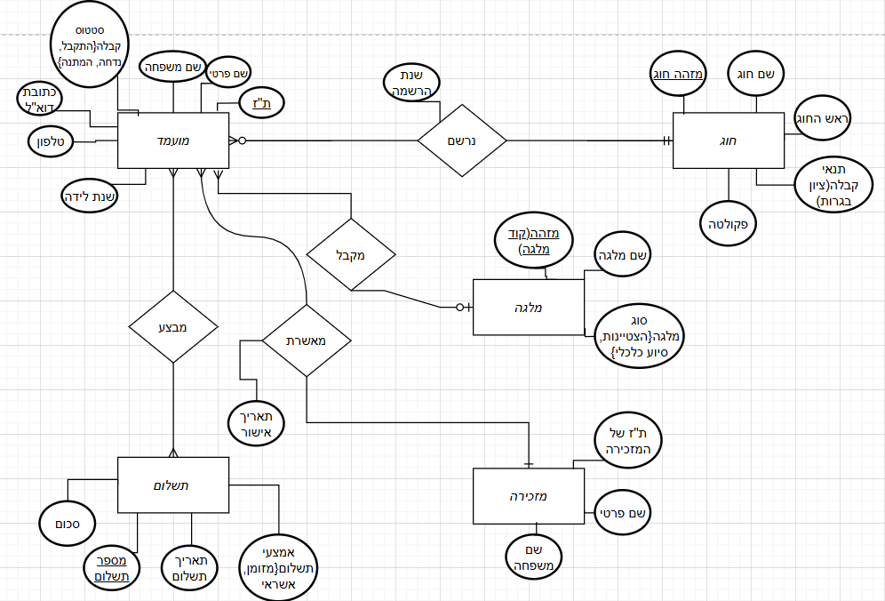
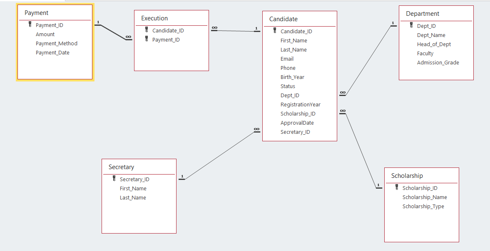

# University Admissions Database Design 🎓

Database design for a university admissions system: applicants register for study programs, receive scholarships, make payments, and are approved by the admissions office.
The project goes from a conceptual **ERD** to a relational schema implemented in **MS Access**.

> Course project, B.Sc. Information Systems, University of Haifa.

## 📐 ERD (conceptual design)

*The diagram labels are in Hebrew; the English description is below.*

## 🧱 Entities

| Entity | Key | Attributes |
|---|---|---|
| **Applicant** (מועמד) | ID number | first name, last name, email, phone, birth year, status *(accepted / rejected / pending)* |
| **Program** (חוג) | program ID | name, head of program, faculty, admission requirements *(matriculation grade)* |
| **Scholarship** (מלגה) | scholarship code | name, type *(excellence / financial aid)* |
| **Payment** (תשלום) | payment number | amount, payment date, payment method *(cash / credit)* |
| **Secretary** (מזכירה) | secretary ID | first name, last name |

## 🔗 Relationships

| Relationship | Between | Cardinality | Attributes |
|---|---|---|---|
| **Registers** (נרשם) | Applicant → Program | each applicant registers for exactly one program; a program can have many applicants | registration year |
| **Receives** (מקבל) | Applicant → Scholarship | each applicant receives at most one scholarship; a scholarship can be given to many applicants | |
| **Makes** (מבצע) | Applicant ↔ Payment | many-to-many | |
| **Approves** (מאשרת) | Secretary → Applicant | each approval is done by one secretary; a secretary approves many applicants | approval date |

## 🗄 Relational schema (MS Access)

| Table | Primary key | Foreign keys |
|---|---|---|
| **Candidate** | Candidate_ID | Dept_ID → Department, Scholarship_ID → Scholarship, Secretary_ID → Secretary |
| **Department** | Dept_ID | |
| **Scholarship** | Scholarship_ID | |
| **Secretary** | Secretary_ID | |
| **Payment** | Payment_ID | |
| **Execution** | (Candidate_ID, Payment_ID) | Candidate_ID → Candidate, Payment_ID → Payment |

How the ERD was mapped to tables:
- **One-to-many relationships** (Registers, Receives, Approves) became foreign keys in `Candidate`
- **Relationship attributes** moved to the "many" side: `RegistrationYear` and `ApprovalDate` are stored in `Candidate`
- The **many-to-many** relationship *Makes* became the junction table `Execution` with a composite primary key
- Referential integrity is enforced through Access relationships

## 💡 Design concepts

- Primary keys (underlined in the diagram)
- One-to-many and many-to-many relationships with crow's foot notation, including optional participation
- Relationship attributes (registration year, approval date)
- Mapping the ERD to a relational schema with primary, foreign and composite keys
- Attributes with a fixed set of allowed values (status, scholarship type, payment method)
